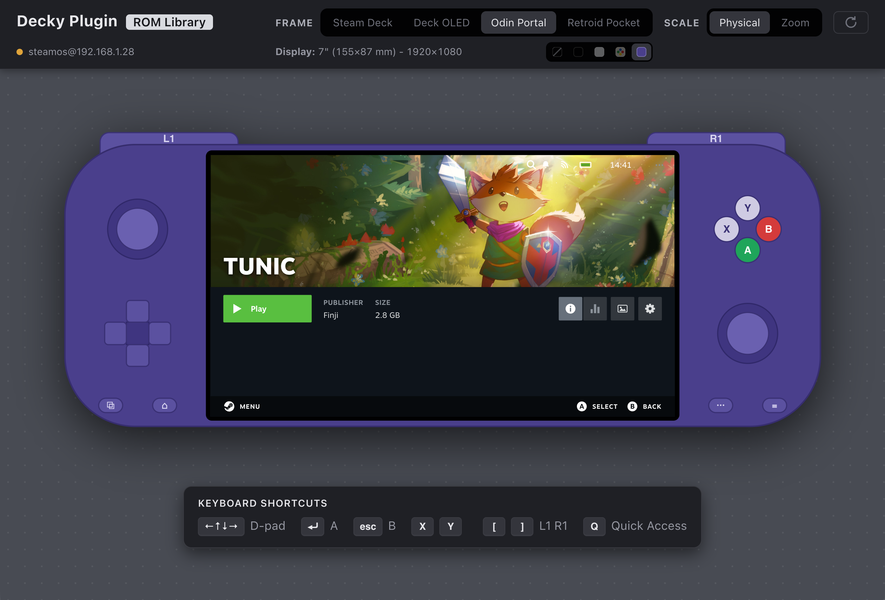

# decky-vite

decky-vite helps create Decky plugins by providing a fast feedback loop during development. It features:

- a hot reload web view, powered by Vite's HMR;
- a true-to-scale web view of a Steam Deck, Steam Deck OLED, Odin 2 Portal or Retroid Pocket 5 screen;
- emulated gamepad navigation;
- local fixtures, or a direct link to the plugin's backend on a real console.

The plugin's pages run inside fakes of Steam's game mode and of Decky.

## Install

decky-vite needs Node 24. The true-to-scale view needs macOS, where Swift from the Xcode Command Line Tools reads the screen's size. Elsewhere the screen fits the window.

Clone decky-vite next to the plugin, then:

    npm install

Steam's Motiva Sans font and its controller glyphs are Valve's files. Fetch them either from a device or from GitHub:

    npx fetch-assets --device steamdeck.local
    npx fetch-assets --github

A device gives the font and the glyphs. GitHub gives the glyphs alone, from SteamDatabase's copy of the Steam client. If fetching from a device, the console must run Steam in game mode with Decky Loader, which opens Steam's debug port.

The files go to `steam/`. Without them the screen uses Helvetica Neue and letters for the buttons.

## Run

    npm run dev -- --plugin ../my-plugin

Open http://localhost:5199. The screen shows the plugin's first route on a Steam Deck. The bar above it picks the handheld's colours or no frame, picks the model, switches between the physical size and the window's, and reloads the screen. Set `DECKY_VITE_PLUGIN` in `.env` to drop `--plugin`.

## The backend: fixtures or a console

The plugin's pages call its backend through `callable` from `@decky/api`. decky-vite answers each call from a console or from a fixture.

### On a console

    npm run dev -- --plugin ../my-plugin --device steamdeck.local

decky-vite copies the backend files to `~/.cache/decky-vite/<slug>/` on the console and runs them there, for example a Python `main.py` with its `py_modules`. `<slug>` is the `name` in the plugin's `package.json`. The backend works on copies of the plugin's Decky settings and data folders: the installed plugin keeps its own. A change to a backend file restarts the backend and reloads the screen.

The console needs an ssh login with a key, since decky-vite never asks for a password, and python3 and rsync, which SteamOS has.

The fake Steam starts from the console's shortcuts, custom images and collections.

### Local fixtures

decky-vite records each answer from the console in `fixtures/<slug>/<method>/<key>.json`. Without a console, or when it does not answer, decky-vite replays the answer to the same call. A call with neither fails with `no device, no fixture`.

`<key>` is the first 16 hex digits of the SHA-1 of the call's arguments in JSON. To write a fixture by hand:

    printf '%s' '["n64"]' | shasum | cut -c1-16

A call without arguments reads `97d170e1550eee4a.json`.

## Command line

    npm run dev [-- options]
    npx fetch-assets [--device <[user@]host> | --github]

- `--plugin <folder>`: the plugin, relative to the folder npm runs in.
- `--device <[user@]host>`: the console that runs the backend, as user `deck` by default.
- `--ssh="<options>"`: more ssh options, for example `--ssh="-o Port=2222"`. Your ssh config applies. The value starts with a dash and needs the `=`.
- `--model <model>`: `deck` (default), `deck-oled`, `odin2-portal` or `rp5`.
- `--port <port>`: 5199 by default.
- `--route <path>`: the page shown at start.
- `--github`: `fetch-assets` takes the glyphs from GitHub.

## Configuration

decky-vite takes each setting from the first of these that sets it:

1. the command line;
2. the environment's `DECKY_VITE_*` variables;
3. `.env` in decky-vite's folder;
4. `decky-vite.json` at the plugin's root, else the `"decky-vite"` key of its
   `package.json`;
5. the defaults.

### .env

    DECKY_VITE_PLUGIN=../my-plugin
    DECKY_VITE_DEVICE=steamdeck.local
    DECKY_VITE_SSH="-i ~/.ssh/deck"
    DECKY_VITE_MODEL=deck-oled
    DECKY_VITE_PORT=5199

A relative plugin path starts from decky-vite's folder.

### decky-vite.json

    {
      "entry": "src/index.tsx",
      "backend": ["main.py", "py_modules", "defaults/"],
      "decky": "~/homebrew",
      "route": "/my-plugin",
      "hooks": "decky-vite.hooks.ts",
      "manifest": "plugin.json"
    }

The same keys can sit under `"decky-vite"` in the plugin's `package.json`.

- `entry`: the frontend entry, `src/index.tsx` by default.
- `backend`: the files copied to the console, `["main.py", "py_modules", "defaults/"]` by default. A trailing slash copies a folder's contents.
- `decky`: Decky's folder on the console, `~/homebrew` by default.
- `route`: the page shown at start. By default the plugin's first route; with none, the library with the Quick Access menu open.
- `manifest`: the plugin's `plugin.json`, at the plugin's root by default.
- `hooks`: a module for decky-vite, relative to the plugin. It exports `setup()`, run once the fake Steam has started and the plugin is defined, and `persist: { save(), restore(saved) }`, which keeps the plugin's state across full reloads.

## Keys

| Steam        | Keyboard       | Controller        |
|--------------|----------------|-------------------|
| D-pad        | arrows         | D-pad, left stick |
| A            | Enter, Space   | A                 |
| B            | Esc, Backspace | B                 |
| X, Y         | X, Y           | X, Y              |
| L1, R1       | [ and ]        | LB, RB            |
| Quick Access | Q              | Select            |

A click on the handheld's sketch presses its buttons.

## Develop decky-vite

`npm run check` type-checks decky-vite.
